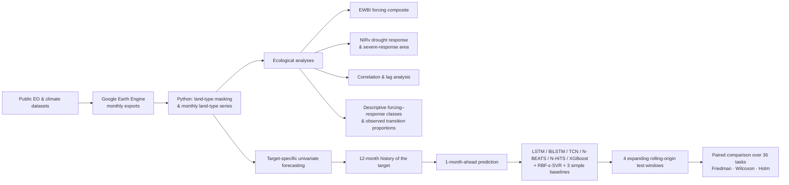

# Integrating Multi-Sensor Earth Observation and Deep Learning for Drought Forecasting and Vegetation Response in California

Code for a study of drought forcing and vegetation response across California's grasslands, natural forests, savannas and
shrublands (2001–2024). Monthly satellite and climate records are summarised per land type to (i) describe drought forcing with
an equal-weight forcing composite (EWBI) and vegetation response with NIRv, and (ii) benchmark one-month-ahead forecasting of
nine indicators with deep-learning, tree-based and simple baseline models. *Manuscript under revision at Ecological Informatics.*



## At a glance

| | |
|---|---|
| **Region / period** | California, monthly, 2001–2024 (baseline 2001–2011; focal periods 2012–2016 and 2020–2024) |
| **Land types** | Grasslands, Natural Forests, Savannas, Shrublands (MODIS MCD12Q1 2021) |
| **Vegetation / productivity** | NDVI, GNDVI, NIRv, GOSIF/SIF, GPP (FLUXCOM-X-BASE 2001–2021; MOD17A2H 2022–2024) |
| **Hydroclimate / thermal** | SPEI-1, GRACE/GRACE-FO TWS, VPDmax, LST |
| **EWBI** | equal-weight mean of +SPEI-1, +TWS, −VPDmax, −LST; each land-type monthly series is deseasonalised and standardised **over time** against its 2001–2011 baseline (no spatial standardisation). A relative, baseline-referenced, multi-timescale forcing composite — not a calibrated drought-intensity index |
| **States** | descriptive median-based EWBI × NIRv classes; empirical month-to-month transition proportions (not a fitted Markov model), compared with an autocorrelation-preserving IAAFT null |
| **Forecasting** | univariate per target: each of 9 targets × 4 land types (36 tasks) is predicted 1 month ahead from its own previous 12 months |
| **Evaluation** | expanding rolling origin, test windows 2017–18, 2019–20, 2021–22, 2023–24; R² and nRMSE; training-only preprocessing |
| **BiLSTM** | first recurrent layer bidirectional for all targets; 128 units per direction (NDVI, GNDVI, NIRv, GOSIF/SIF, GPP, LST, VPDmax), 150 (TWS), 200 (SPEI-1) |
| **Pixels** | per task, minimum finite-month counts of floor(0.30 × N) before 2022 (75/252) and in 2024 (3/12); at most 100 drawn at random (seed 42), reused across models and folds |
| **Inference** | 36 target × land-type tasks as paired units (pixels are not replicates); Friedman test, then two-sided Wilcoxon signed-rank tests with Holm correction |

> **Common benchmark for all Figure 7 cells.** All 216 model–task cells of Figure 7 (and of the derived Tables 4–5, Figure S8
> and the statistical comparison) come from the common 12-month benchmark. The 18-month TWS BiLSTM run in
> `src/forecasting/tws_bilstm_special/` is a supplementary hydroclimate sensitivity and is not used in the main common 12-month
> Figure 7 benchmark (details in [`docs/REPRODUCIBILITY.md`](docs/REPRODUCIBILITY.md)).

## Repository map

| Folder | Contents |
|---|---|
| [`gee/`](gee) | Google Earth Engine (JavaScript) export scripts |
| [`src/preprocessing/`](src/preprocessing) | Python: land-type masking, monthly land-type series, anomalies |
| [`src/ecological/`](src/ecological) | EWBI, states and transitions, NIRv response, gap filling, correlations, GPP and sensitivity analyses |
| [`src/forecasting/`](src/forecasting) | pixel screening, folds, baselines, models, SVR, corrected BiLSTM |
| [`src/statistics/`](src/statistics) | model-comparison tests; IAAFT state-transition null |
| [`src/figures/`](src/figures), [`src/tables/`](src/tables) | figure and table scripts |
| [`results/`](results) | compact final source tables and statistical outputs (no raster data) |
| [`config/`](config) | hyperparameters, folds, seeds, pixel-selection rule and counts |
| [`environment/`](environment) | pinned package versions |
| [`data_access/`](data_access) | data sources and how to obtain them |
| [`docs/`](docs) | [workflow](docs/WORKFLOW.md), [reproducibility](docs/REPRODUCIBILITY.md), [data availability](docs/DATA_AVAILABILITY.md), [file provenance](docs/FILE_PROVENANCE.md), [QC report](docs/REPOSITORY_QC_REPORT.md) |

## Figures

| Figure | Script |
|---|---|
| 1 Land types | `src/figures/fig01_landtype_map.py` |
| 2 Workflow | diagram (not code-generated) |
| 3–4 Standardised anomalies | `src/figures/fig03_fig04_anomaly_timeseries.py` |
| 5 Raw monthly correlations (exact YYYY-MM pairs) | `src/ecological/correlations/figure5_date_aligned_correlations.py`; rendering `src/figures/refined_figures_fig5_S4_S5_S6_S7_S9_null.py` |
| 6 Cross-correlation functions | `src/figures/fig06_cross_correlation.py` (values: `ccf_calculate` in `src/ecological/correlations/cross_correlation_and_submitted_fig5_logic.py`) |
| 7 Forecast skill (mean ± SD per task; descriptive best-model counts) | `src/figures/fig07_point_errorbar_best_counts.py` ← `results/forecasting/figure7_final_task_metrics.csv` |
| 8 NIRv change maps | `src/figures/fig08_nirv_change_maps.py` |
| 9 Observed transition proportions | `src/figures/fig09_transition_matrices.py` |
| Supplementary: TWS support / resampling | `src/figures/figS01_tws_resampling.py` |
| Supplementary: gap filling; detrending | `src/figures/figS02_S03_S04_S05_supplementary.py` (`build_s4`, `build_s5`) |
| Supplementary: EWBI components & weighting; period-stratified responses; state-classification alternatives | `src/ecological/sensitivity/harmonized_S4_S5_S6.py`; rendering `src/figures/refined_figures_fig5_S4_S5_S6_S7_S9_null.py` |
| Supplementary: baselines and folds; forecast-derived EWBI | `src/forecasting/corrected_bilstm/reconcile_corrected_bilstm_figures.py`; rendering as above |
| Supplementary: forecast heatmaps | `src/figures/figS08_forecast_heatmaps.py` |
| Supplementary: NIRv threshold sensitivity | `src/figures/figS10_nirv_threshold_sensitivity.py` |
| Supplementary: Figure-5 deseasonalised sensitivity; IAAFT null | `src/figures/refined_figures_fig5_S4_S5_S6_S7_S9_null.py`, `src/figures/fig09_transition_matrices.py` |

Tables: hyperparameters and folds — `config/`; Figure 7 source on the common 12-month benchmark —
`src/tables/figure7_tws_common_benchmark_correction.py`; forecast rankings / predictability (Tables 4–5) —
`src/tables/tables_4_5_from_corrected_figure7.py`; NIRv response tables — `src/tables/verify_tables_2_4_5_6.py`
and `src/tables/rebuild_corrected_tables_3_4.py`; pairwise statistics — `src/tables/forecast_pairwise_statistics_table.py`;
EWBI temporal variation — `src/tables/ewbi_temporal_variation_table.py`; pixel counts — `config/pixel_selection_counts.csv`.

## Data

No data are included. Source datasets are public and listed in [`data_access/data_sources.csv`](data_access/data_sources.csv).
Processed and derived datasets are available from the corresponding author on reasonable request
([`docs/DATA_AVAILABILITY.md`](docs/DATA_AVAILABILITY.md)).

## Reproducing

```bash
pip install -r environment/requirements.txt
python src/statistics/forecast_model_comparison.py      # runs from bundled results/ tables
python src/statistics/state_transition_iaaft_null.py    # runs from bundled results/ tables
```
Everything else follows [`docs/WORKFLOW.md`](docs/WORKFLOW.md); scripts that read raster data contain path placeholders
(`<DATA_ROOT>`, `<PROJECT_ROOT>`) to set first. Configuration notes and known gaps: [`docs/REPRODUCIBILITY.md`](docs/REPRODUCIBILITY.md).

## License

Code and documentation: [MIT](LICENSE). Third-party datasets keep their providers' terms and are not redistributed.
