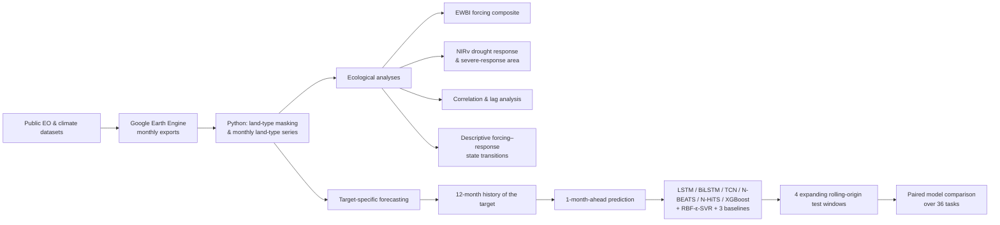

# Integrating Multi-Sensor Earth Observation and Deep Learning for Drought Forecasting and Vegetation Response in California

Code for a study of drought forcing and vegetation response across California's grasslands, natural forests, savannas and
shrublands (2001–2024). Monthly satellite and climate records are summarised per land type to (i) describe drought forcing with
an equal-weight forcing composite (EWBI) and vegetation response with NIRv, and (ii) benchmark one-month-ahead forecasting of
nine indicators with deep-learning, tree-based and simple baseline models. *Manuscript under revision at Ecological Informatics.*



## At a glance

| | |
|---|---|
| **Region / period** | California, monthly, 2001–2024 (baseline 2001–2011; drought periods 2012–2016 and 2020–2024) |
| **Land types** | Grasslands, Natural Forests, Savannas, Shrublands (MODIS MCD12Q1 2021) |
| **Vegetation / productivity** | NDVI, GNDVI, NIRv, GOSIF/SIF, GPP |
| **Hydroclimate / thermal** | SPEI-1, GRACE/GRACE-FO TWS, VPDmax, LST |
| **EWBI** | mean of +SPEI-1, +TWS, −VPDmax, −LST, each standardised over time against its 2001–2011 land-type baseline; a relative forcing composite, not a calibrated drought-intensity index |
| **Forecasting** | univariate per target (9 targets × 4 land types = 36 tasks); 12-month input window; 1 month ahead |
| **Evaluation** | expanding rolling origin, test windows 2017–18, 2019–20, 2021–22, 2023–24; R² and nRMSE |
| **Pixels** | per task, pixels with ≥ 30 % valid months before 2022 and in 2024; at most 100 drawn at random (seed 42), reused across models and folds |

## Repository map

| Folder | Contents |
|---|---|
| [`gee/`](gee) | Google Earth Engine (JavaScript) export scripts |
| [`src/preprocessing/`](src/preprocessing) | Python: land-type masking, monthly land-type series, anomalies |
| [`src/ecological/`](src/ecological) | EWBI, states and transitions, NIRv response, gap filling, correlations, sensitivity analyses |
| [`src/forecasting/`](src/forecasting) | pixel screening, folds, baselines, models, SVR, corrected BiLSTM |
| [`src/figures/`](src/figures), [`src/tables/`](src/tables) | figure and table scripts |
| [`config/`](config) | hyperparameters, folds, seeds, pixel-selection rule and counts |
| [`environment/`](environment) | pinned package versions |
| [`data_access/`](data_access) | data sources and how to obtain them |
| [`docs/`](docs) | [workflow](docs/WORKFLOW.md), [reproducibility](docs/REPRODUCIBILITY.md), [data availability](docs/DATA_AVAILABILITY.md), [file provenance](docs/FILE_PROVENANCE.md) |

## Figures and tables

| Item | Script |
|---|---|
| Fig. 1 land types | `src/figures/fig01_landtype_map.py` |
| Fig. 2 workflow | diagram (not code-generated) |
| Figs. 3–4 standardised anomalies | `src/figures/fig03_fig04_anomaly_timeseries.py` |
| Figs. 5–6 correlations, cross-correlation | `src/preprocessing/02_landtype_series/03_previous_gndvi_series_and_figures_5_6.py`, `src/figures/fig06_cross_correlation.py` |
| Fig. 7 forecast skill (polar) | `src/figures/fig07_render_corrected_polar.py` |
| Fig. 8 NIRv change maps | `src/figures/fig08_nirv_change_maps.py` |
| Fig. 9 state transitions | `src/figures/fig09_transition_matrices.py` |
| Figs. S1–S10 | `src/figures/figS01_*.py` … `figS10_*.py` (S2–S5 in one script) |
| Tables 3–4 model rankings / predictability | `src/tables/rebuild_corrected_tables_3_4.py` |
| Hyperparameters, folds, pixel counts | `config/` |

## Data

No data are included. All source datasets are public ([`data_access/data_sources.csv`](data_access/data_sources.csv)).
Processed and derived datasets are available from the corresponding author on reasonable request
([`docs/DATA_AVAILABILITY.md`](docs/DATA_AVAILABILITY.md)).

## Reproducing

```bash
pip install -r environment/requirements.txt
```
Then follow [`docs/WORKFLOW.md`](docs/WORKFLOW.md). Scripts contain path placeholders (`<DATA_ROOT>`, `<PROJECT_ROOT>`) to set
before running. Notes on configurations and known gaps: [`docs/REPRODUCIBILITY.md`](docs/REPRODUCIBILITY.md).

## License

See [LICENSE](LICENSE).
